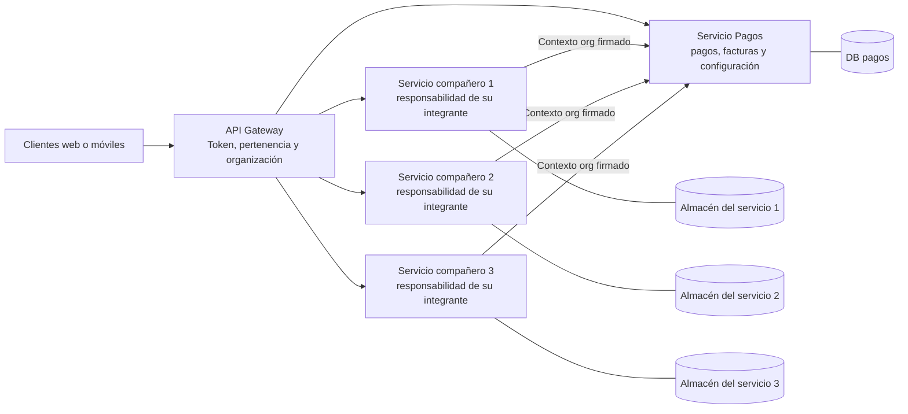
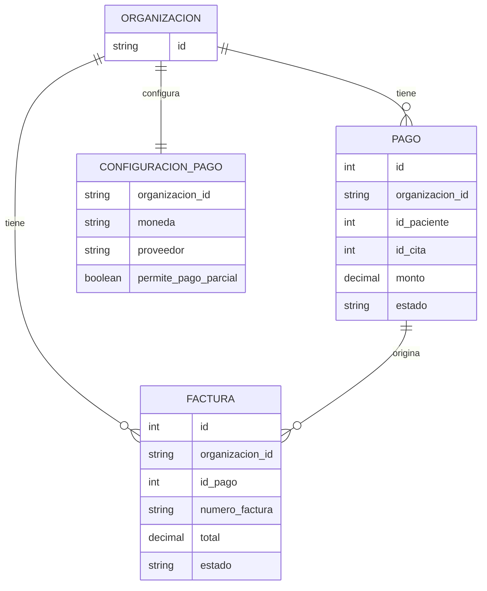
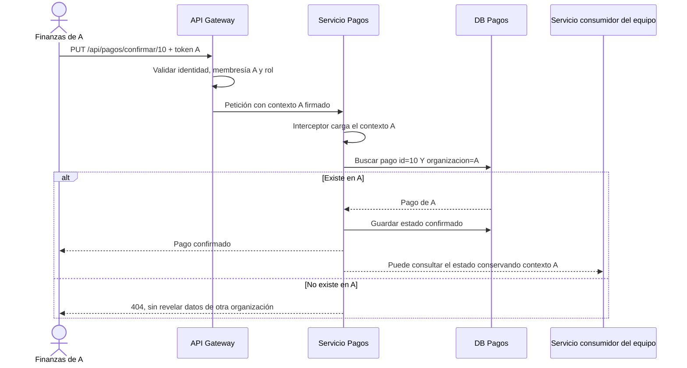

# Dos organizaciones, un producto: plataforma dental SaaS

## 1. Alcance

Este repositorio contiene únicamente el **servicio de pasarela de pagos** de un
proyecto de cuatro servicios. Sus responsabilidades son pagos, facturas y la
configuración de cobro. 

Una instalación y un despliegue del servicio de pagos atienden a varias
organizaciones sin mezclar sus datos.

El servicio de pagos implementa aislamiento por `organizacion_id`, permisos
básicos por rol, validación del contexto propagado entre servicios y
configuración independiente por organización.

## 2. Dos organizaciones ficticias

### Clínica Sonrisa A

- Red con dos sucursales.
- Opera en MXN con pagos de contado y tarjeta.
- Permite pagos parciales.
- Roles frecuentes: administrador, finanzas y lectura.
- Quiere facturas numeradas e historial por paciente dentro de su propia red.

### Centro Dental Nova B

- Una sola sucursal y un flujo de atención menor.
- Opera en USD mediante transferencia.
- No permite pagos parciales.
- Utiliza perfiles de administrador y caja.
- Solo su personal puede consultar sus pagos y facturas.

Aunque ambas usan el mismo producto, sus usuarios, configuración y registros no
se comparten. El identificador de organización forma parte del contexto de cada
petición.

## 3. Usuarios, pertenencias y permisos

La pertenencia debe ser emitida por el Gateway o por el servicio de identidad
administrado por otro integrante. Para Pagos es contexto autenticado y no un
atributo elegido por el cliente.

| Usuario ficticio | Pertenencia | Rol | Permisos en Pagos |
|---|---|---|---|
| Ana | Clínica A | ADMIN | Configurar, crear, consultar, confirmar y cancelar |
| Bruno | Clínica A | FINANZAS | Crear, consultar, facturar, confirmar y cancelar |
| Carla | Clínica A | LECTOR | Consultar |
| Nerea | Centro B | ADMIN | Solo administrar recursos de Centro B |
| Omar | Centro B | FINANZAS | Solo operar recursos de Centro B |
| Servicio compañero | A o B por solicitud | SERVICIO | Consultar/crear pagos únicamente con el contexto propagado |

Reglas generales:

1. Pertenencia al servicio y rol no son lo mismo; el rol se evalúa únicamente
   después de validar la pertenencia.
2. Un encabezado de organización no concede acceso. En producción debe ser
   emitido por un API Gateway después de validar un token.
3. El rol `SERVICIO` no puede cambiar el identificador organizacional recibido.
4. Un `LECTOR` no puede modificar pagos ni configuración.
5. Solo `ADMIN` modifica la configuración de pagos.

### Autenticación de la implementación

Este proyecto académico recibe de su puerta de enlace:

```http
X-Organization-Id: ORG-A
X-User-Id: ana
X-User-Role: FINANZAS
```

Las cabeceras son **contexto interno ya autenticado**. Antes de exponer este
servicio a Internet, el API Gateway debe firmar el contexto (token JWT o mTLS) y
eliminar cabeceras recibidas directamente del navegador.

## 4. Diagrama de arquitectura



La arquitectura muestra los cuatro servicios del equipo, pero este repositorio
sólo implementa Pagos. Los nombres y modelos de los otros tres servicios deben
ser completados por sus responsables y sus almacenes se tratan aquí como cajas
independientes. Pagos recibe de ellos un contexto firmado, nunca un identificador
organizacional arbitrario.

## 5. Modelo de datos de este servicio

En Pagos, el par `organizacion_id + id_recurso` es la identidad de acceso
efectiva. Cada compañero debe documentar y aplicar el mismo principio en su propio
modelo.

| Entidad | Representación de pertenencia |
|---|---|
| `pago` | `organizacion_id` obligatorio; no se reemplaza mediante el cuerpo JSON |
| `factura` | `organizacion_id` y referencia validada al pago de la misma organización |
| `configuracion_pago` | `organizacion_id` como clave primaria; una fila por organización |



`Factura.id_pago` no basta para validar la relación: el servicio busca el pago
por `id + organizacion_id`. Así, un pago de A no puede facturarse desde B.

## 6. Estrategia de almacenamiento

Se eligió una base compartida con **fila discriminada por organización**:

- Cada tabla operativa contiene `organizacion_id`.
- Los repositorios sólo exponen consultas que incluyen organización.
- Los índices `idx_pagos_organizacion` e `idx_facturas_organizacion` evitan
  recorrer los datos de todas las clínicas.
- La combinación `organizacion_id + numero_factura` permite que cada clínica
  controle su propia numeración.
- La base de Pagos es independiente de los almacenes que implementen los demás
  compañeros.

Esta estrategia reduce costo operativo comparada con una base por cliente y evita
la duplicación de esquemas. A cambio, exige controles sistemáticos en cada
consulta. Si una organización requiriera residencia física o cifrado con claves
separadas, podría aislarse en una base dedicada sin cambiar el contrato público.

## 7. Diagrama de secuencia de una operación principal

Operación principal de este repositorio: confirmar un pago y devolver el nuevo
estado. La generación de factura es una operación posterior del mismo servicio.



## 8. Casos de prueba de aislamiento

Los siguientes son especificaciones de aceptación. Los primeros tres escenarios
también cuentan con pruebas automatizadas de servicio en este repositorio.

| Situación | Preparación | Acción | Resultado esperado |
|---|---|---|---|
| Usuario de A consulta sus registros | Pago 10 pertenece a A | A lista/abre pagos con su contexto | Obtiene únicamente información autorizada de A |
| Usuario de A intenta consultar un registro de B | Pago 77 pertenece a B | A solicita `GET /api/pagos/77` | HTTP 404; no obtiene ni confirma la existencia del registro |
| Usuario intenta modificar la organización de una solicitud | Petición original tiene A | Agrega o cambia `organizacion_id` en el JSON | El campo no cambia el contexto; se usa A validado por el Gateway |
| Organización A cambia su configuración | Existen configuración A y B | ADMIN A guarda moneda/proveedor | La configuración de B permanece exactamente igual |
| Un servicio consulta a Pagos | Compañero A llama Pagos | Envía contexto A firmado | Pagos conserva A y lo vuelve a validar en cada consulta |
| Un préstamo de A referencia un equipo de B | Escenario de servicio de otro compañero | Se intenta la referencia cruzada | La operación se rechaza en el servicio dueño del préstamo/equipo |
| FINANZAS de A genera factura de pago B | Pago pertenece a B | A usa el `id_pago` de B | HTTP 400 sin crear factura |
| LECTOR intenta confirmar un pago | LECTOR pertenece a A | Envía `PUT /confirmar` | HTTP 403; el pago no cambia |
| Petición carece de contexto | No hay cabeceras internas | Consulta cualquier endpoint | HTTP 401 antes de ejecutar lógica o SQL |
| Dos facturas usan el mismo número local | Cada organización genera su número | Se guarda una en A y una en B | Ambas pueden existir por la restricción compuesta |

## 9. Participación del servicio personalizado

La pasarela de pagos respeta los límites organizacionales en cinco capas:

1. `InterceptorOrganizacion` exige organización, usuario y rol.
2. `ContextoOrganizacion` mantiene el contexto durante una petición y lo elimina
   al terminar, evitando contaminar peticiones concurrentes.
3. Cada entidad guarda `organizacion_id`.
4. Los repositorios siempre buscan con organización más identificador.
5. La creación de facturas verifica que el pago referenciado pertenezca a la
   misma organización.

También participa en el flujo al confirmar cobros y emitir facturas. Los demás
servicios consumen su resultado conservando su contexto firmado. Si una operación
cruza límites, Pagos devuelve un error que no revela datos.

## 10. Base de datos y ubicación del almacenamiento

La pasarela usa **PostgreSQL** mediante Spring Data JPA. Los registros no se
guardan dentro de este repositorio ni en archivos locales del servicio: se
almacenan en el servidor PostgreSQL indicado por la cadena JDBC.

### Conexión predeterminada

La conexión local está definida en
`src/main/resources/application.properties`:

| Propiedad | Valor predeterminado | Variable para sobrescribirla |
|---|---|---|
| Servidor | `localhost` | `DB_URL` |
| Puerto | `5432` | `DB_URL` |
| Base de datos | `pagos_soa` | `DB_URL` |
| Usuario | `postgres` | `DB_USERNAME` |
| Contraseña | Sin valor predeterminado | `DB_PASSWORD` |

En consecuencia, durante el desarrollo los datos se almacenan en el clúster
PostgreSQL local, en la base de datos `pagos_soa`. En producción se debe indicar
la ubicación real con variables de entorno y no dejar credenciales en el
código:

```powershell
$env:PORT="8084"
$env:DB_URL="jdbc:postgresql://servidor:5432/pagos_soa"
$env:DB_USERNAME="usuario_pagos"
$env:DB_PASSWORD="contraseña_segura"
$env:CORS_ALLOWED_ORIGINS="https://gateway.ejemplo.com"
mvn spring-boot:run
```

Los archivos físicos pertenecen a PostgreSQL y su ruta depende de cómo fue
instalado y configurado el servidor. Se puede consultar directamente al
servidor, sin adivinar la ruta:

```sql
SHOW data_directory;
SELECT current_database(), current_user, inet_server_addr(), inet_server_port();
```

Por seguridad, las aplicaciones no deben leer ni modificar directamente esos
archivos. El acceso a los datos debe hacerse mediante PostgreSQL, realizando
copias de seguridad con herramientas como `pg_dump`.

### Esquema almacenado

El archivo `pagos.sql` documenta el esquema inicial y contiene tres tablas:

| Tabla | Contenido |
|---|---|
| `pagos` | Cobros, paciente, cita, monto, método, estado y referencia |
| `facturas` | Facturas emitidas y relación con el pago |
| `configuraciones_pago` | Moneda, proveedor y pago parcial de cada organización |

Las tres tablas incluyen el contexto multiorganización. `pagos` y `facturas`
conservan `organizacion_id` en cada fila; en `configuraciones_pago` ese campo es
la clave primaria. La combinación `organizacion_id + numero_factura` es única,
por lo que cada organización mantiene su propia numeración de facturas.

El esquema también crea los índices:

- `idx_pagos_organizacion`
- `idx_facturas_organizacion`

### Creación e inicialización

Antes del primer arranque debe existir la base `pagos_soa` en PostgreSQL:

```bash
createdb -U postgres pagos_soa
psql -U postgres -d pagos_soa -f pagos.sql
```

`spring.jpa.hibernate.ddl-auto=update` permite que Hibernate actualice el
esquema según las entidades al iniciar. Para producción se recomienda controlar
los cambios con migraciones versionadas, en vez de depender de `update`.

`pagos.sql` crea tablas e índices, pero no crea la base de datos ni sus
credenciales. Los datos de los demás servicios del equipo se mantienen en
almacenes independientes y fuera de esta base.

## 11. Ejecución

Requisitos: Java 17, Maven y PostgreSQL.

```bash
mvn clean test
mvn spring-boot:run
```

El servicio puede ejecutarse directamente desde el VPS con el JAR generado:

```bash
mvn clean package
java -jar target/pasarela-pagos-1.0.jar
```

La plantilla `.env.example` muestra las variables admitidas. El nombre de la
base, las credenciales y los orígenes CORS se deben configurar en el VPS. La
aplicación escucha por defecto en el puerto `8084` y admite cambiarlo con
`PORT`.

El endpoint `GET /actuator/health` sirve para verificar que el proceso está
disponible y comprobar la conexión a PostgreSQL. No requiere las cabeceras de
organización. El resto de las rutas bajo `/api/**` sí exige el contexto firmado
por la puerta de enlace.

### Contrato de integración entre servicios

Los demás servicios deben enviar estas cabeceras al consultar o modificar datos:

```http
X-Organization-Id: ORG-A
X-User-Id: ana
X-User-Role: SERVICIO
```

El `X-Organization-Id` debe representar a la organización autenticada por la
puerta de enlace. Un servicio consumidor no puede decidir libremente esta
cabecera desde el navegador.

Rutas disponibles:

| Recurso | Operaciones |
|---|---|
| `/api/pagos` | Registrar, listar, consultar, confirmar y cancelar |
| `/api/facturas` | Generar, listar, consultar y anular |
| `/api/configuracion` | Consultar y guardar, solo con rol `ADMIN` |
| `/actuator/health` | Salud del servicio y de PostgreSQL |

Si la integración se realiza entre servicios del mismo VPS, no es necesario
habilitar CORS. `CORS_ALLOWED_ORIGINS` sólo se configura cuando un navegador usa
directamente este servicio; puede contener una URL o una lista separada por
comas.

Ejemplo de petición:

```bash
curl -X POST http://localhost:8084/api/pagos/registrar \
  -H "Content-Type: application/json" \
  -H "X-Organization-Id: ORG-A" \
  -H "X-User-Id: ana" \
  -H "X-User-Role: FINANZAS" \
  -d '{"idPaciente":12,"idCita":8,"monto":500.00,"metodoPago":"tarjeta"}'
```

La configuración JDBC usa las variables `DB_URL`, `DB_USERNAME` y
`DB_PASSWORD`. El puerto usa `PORT` y los navegadores permitidos se definen con
`CORS_ALLOWED_ORIGINS`. `DB_PASSWORD` debe proporcionarse desde el entorno.

## 12. Entregable y criterios cubiertos

- Descripción diferenciada de dos organizaciones.
- Matriz de usuarios, membresías, roles y permisos.
- Arquitectura de integración con cuatro servicios; tres quedan a cargo de los compañeros.
- Modelo y pertenencia detallados del servicio de Pagos.
- Justificación de la estrategia de almacenamiento.
- Secuencia de la operación principal.
- Casos de prueba de aislamiento como especificación.
- Explicación específica del servicio de pasarela de pagos.
- Implementación demostrativa con pruebas de aislamiento.
